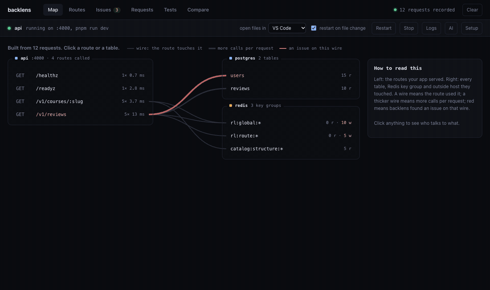

# backlens

**See what your Node backend really does on every request, find what is slow, and get the fix proven before you keep it.**

[](https://www.npmjs.com/package/backlens)
[](LICENSE)
[](package.json)

```
npx backlens
```

One command, in your server's folder. No code changes, no account, nothing leaves your machine.



---

## What it does

backlens runs your app with a small recorder inside it and opens a dashboard in your browser. As you use your app, every request shows up with the database queries, Redis calls and outgoing HTTP calls it made, and the line of your code behind each one.

From that real traffic it finds what makes backends slow:

| Issue | What it looks like | Example |
|---|---|---|
| **N+1** | one query run once per item in a loop | 20 reviews → 20 `select name from users where id = $1` |
| **Repeated calls** | the same query with the same values twice in one request | two services both load the current user |
| **Calls that wait for each other** | independent queries awaited one after another | `await getCounts(); await getRows();` |
| **Missing indexes** | Postgres reads every row to filter a table | `where state = $1 order by updated_at desc`, no index |

Each issue points at the file and line that caused it, opens in your editor, and can be explained or fixed.

## Fixes, with proof

**Suggest fix** shows the change as a diff. **Apply and check** then:

1. keeps an exact copy of every file it touches
2. applies the change and runs your typecheck (type errors go back to the model, up to twice)
3. restarts your app, warms it up, and replays the request that showed the issue
4. runs your tests

Only a change that removes the issue and keeps the tests green is marked **proven**, and you see the same request before and after:

```
                    before      after
time (median)       48 ms   →   21 ms   -56%
database queries    22      →   2       -91%
issue               found   →   gone
```

Then **Keep** it, or **Revert** to the exact files you had.

Some fixes need no AI: running independent calls together (`Promise.all`) and missing indexes are written by backlens itself. A missing index can be created on your dev database from the dashboard, checked against the query's plan, and undone.

## AI: none, local or Claude

Set up in **AI settings**, entirely from the dashboard.

| | Cost | Privacy | Good for |
|---|---|---|---|
| **No model** | free | nothing leaves your machine | plain explanations, the built-in fixes |
| **Local model** via [Ollama](https://ollama.com) | free | code stays on your machine | explaining; fixes are hit-and-miss on small models |
| **Claude**, your own key | a few cents per fix | what the preview shows is sent to Anthropic | the strongest fixes |

- The local card links to the Ollama download, notices when it runs, suggests the `qwen2.5-coder` size that fits your memory and downloads it with a progress bar.
- A Claude key is pasted in the dashboard, checked for free, and saved in your user folder (`~/.config/backlens`, readable by you only), never in the project. Haiku explains; Sonnet or Opus fixes, depending on how hard the issue is. The cost is estimated before sending and a daily budget (default $1) is enforced. A typical fix costs about $0.03.

## In your AI editor (MCP)

Let Claude Code, Cursor or any MCP client see what your requests do, change the code, and check the change on the same request.

```
claude mcp add backlens -- npx -y backlens@latest mcp
```

Cursor (`.cursor/mcp.json`) and others:

```json
{ "mcpServers": { "backlens": { "command": "npx", "args": ["-y", "backlens@latest", "mcp", "--root", "${workspaceFolder}"] } } }
```

Keep `npx backlens@latest` running in the server folder; the MCP server reads that session (it finds it in the project, a folder above, or a few below, like `apps/api`). `@latest` matters: without it, `npx` keeps reusing whatever version it cached first, and the dashboard and the MCP server can drift apart. `status` shows both versions and says when they differ. Tools:

| Tool | What the agent gets |
|---|---|
| `status` | is backlens recording, is the app up, traffic and issue counts, recorder and MCP versions |
| `list_issues` | issues worst first, with route, `file:line`, statements, a suggested fix and an example request |
| `list_routes`, `list_requests` | p50, p95, calls per request; recent requests with ids |
| `get_request` | the waterfall of one request: each query, Redis and HTTP call, its time and the code behind it |
| `measure_request` | replays a recorded GET against the code as it is now (warm-up, then median and p25-p75 of runs); measure before and after a change and it compares warm against warm, saying "within noise" when the runs overlap |
| `measure_url` | the same for a path sent as a plain GET (no cookies): public routes, or when nothing is recorded yet |
| `app_logs`, `restart_app`, `run_tests` | the app's output, a restart, the test script with its issues |
| `diff` | what the change did to the whole app: one recorded read per route replayed and compared with a baseline (status, response fields and types, queries, calls, errors, new issues). ✗ broken, ~ changed, ↑ better; silent when nothing changed |
| `accept` | take intended changes into that baseline |
| `save_login` | save how to sign in as a role (from a recorded sign-in), so `as: "admin"` works everywhere |
| `report` | Markdown evidence for a pull request: breaks caught, changes accepted, measured before → after |
| `race` | concurrency probes: a recorded write sent N times one after another, then N at once, rolled back; reports races, duplicate jobs, failures under concurrency |
| `try_fixes` | counterfactual lab: 1–4 candidate fixes for one request, each applied, measured, diffed and tested, then put back; the best is reported (or kept) |
| `memory`, `remember` | what backlens knows about a route or file across sessions (code, tables, issues, past breaks, gaps, races), plus notes |
| `mutate`, `doctor` | mutation lab (which guard changes nothing notices); whether backlens's numbers can be trusted on this app |
| `usage` | what the work cost: tokens and dollars for this prompt, the session and the last 30 days |

A typical loop: *list_issues → get_request → measure (before) → edit → measure again → run_tests → diff*. On a sample N+1 that went from 6 queries and 6.7 ms to 2 queries and 1.6 ms, checked by replay. Writes are never replayed, and parameter values never reach the agent.

### What it costs

The **Agents** tab lists every Claude Code prompt that used backlens, with what it used, its tokens, time, backlens calls, files read and edits. The agent reports the same at the end with `usage`. Token counts come from Claude Code's own logs in `~/.claude/projects`: counts and tool names only, never your prompts or code.

What "cost" means depends on how you pay, and backlens shows the number that is really yours:

| You pay with | backlens shows | From |
|---|---|---|
| A Claude plan (Pro, Max, Team) | the share of your 5-hour and weekly limits the prompt used, like `4% of your 5-hour limit` | Claude Code itself, the same numbers as `/usage` |
| An API key | dollars | token counts × Anthropic's API prices, which is that bill |

On a plan, the API price is shown next to it only for comparison. Plans need this once:

```
npx backlens statusline --install
```

Claude Code hands its status line your plan's limit use on every update, so backlens sits in front of the status line you already have (it keeps printing exactly what it did), saves only those two percentages to `~/.config/backlens`, and passes everything on. `--uninstall` puts your old status line back. The share covers all your Claude use while the prompt ran, chats included.

One real run, a 59-file NestJS API, one prompt with no file names in it:

```
3 issues found and fixed, tests green          2.5 min, 804k tokens (Opus 5.5, $0.61 at API prices)
backlens calls 10, files read 3, edits 4
backlens handed the agent 5k tokens instead of up to 40k of source: 88% less to read
```

The "without backlens" figure is an estimate: the size of the app's source an agent would have to search, against what backlens gave it. Reading code also can't count queries or time them, so it can't prove a fix.

### What did my change break? (`diff`)

Tests cover what someone thought to test. `diff` covers every route the app has served: it keeps one read per route (up to 30), and after a change replays each and compares it with the baseline.

A real run on a NestJS API, after a change that dropped a field from one response:

```
$ npx backlens diff
1 broken: 17 routes checked in 0.5 s.

GET /v1/auth/me
  ✗ response lost $.email

✗ items are breaks: fix them, or if the change is intended, accept those routes.
```

- The first run takes the baseline. `backlens accept [route...]` (or the `accept` tool) takes an intended change in.
- Exit code 1 when something broke, so it can gate a hook or a script.
- **Compared:** status, the response's fields and types (never values), queries, Redis and outgoing calls, failing calls, and new N+1 or repeated calls.
- **Data drift is not a change:** a list empty this time, a field null this time.
- **Time is off by default.** Right after a code change, a dev watcher that is still compiling makes timings noisy. `--time` adds a coarse check (more than 2× and 10 ms, confirmed by a re-run); `measure_request` is the precise tool.
- **The baseline** is `.backlens/behavior.json`, readable by you only: routes, paths and fingerprints, with no headers, cookies or values. Signed-in routes are replayed with the request backlens holds in memory, so after restarting backlens, use such a page once before diffing it.

### Signed-in routes, without handing over passwords

Sign in once in the app, then have the agent save that sign-in as a role:

```
save_login { name: "admin", id: "<the POST /login request>" }
measure_url { url: "/v1/admin/users", as: "admin" }
```

- **Profile file:** `.backlens/profiles.json`, readable by you only. It stores `${env:SEED_ADMIN_PASSWORD}`-style references to your `.env`, never the password itself. A password that is in no `.env` file stays in memory for that session only.
- **Who sees the token:** backlens signs in itself and swaps the token into replays. The agent never sees the token or the password.
- **`diff`:** uses the profile for signed-in routes, even after backlens restarts.

### Replaying writes, rolled back

`measure_request { id, sandbox: true }` replays a recorded POST, PUT or DELETE.

- **What gets undone:** every Postgres query of the request runs in one transaction that is rolled back when the response is done. The app's own `BEGIN`/`COMMIT` become savepoints, so nothing commits.
- **What it refuses:** a request that called out over HTTP, and database calls that don't go through `pg`.
- **What it reports:** Redis writes, which are not undone, and any query that escaped the transaction.

### The gate: `backlens init claude` (or `codex`, `cursor`)

```
npx backlens init claude
```

- **What it adds:** the MCP server, plus a stop hook. When the agent finishes a turn that changed files, the hook runs `diff` on the routes the change can reach. Those are routes whose recorded calls ran a changed file or touch a table it queries. When that can't be told, every route is checked.
- **On a break:** the agent is sent back once with the reason (`✗ GET /v1/me/orders answers 500`).
- **On other changes:** they are noted and accepted.
- **When nothing changed:** it says nothing.
- **When backlens is not running:** it does nothing.
- **Undo:** `--uninstall`.

### Races, fixes side by side, and memory

```
npx backlens race                 # concurrency probes on the newest recorded writes
npx backlens try fixes.json --id <request id> [--keep]
npx backlens memory "POST /v1/orders"
```

- **`race`:** sends a recorded write 5 times one after another, then 5 at once, each set in one rolled-back transaction. If more get through at once (two buyers for the last seat), it's a check-then-act race. Jobs the copies queue are held, never sent to a worker.
- **`try`:** applies each candidate fix in turn, replays the request, diffs and tests, and puts the files back. It reports which fix used the fewest queries or was faster beyond noise, with nothing broken.
- **`memory`:** what backlens has learned about a route or file across sessions: the code it runs, the tables it shares, past breaks, mutation gaps, races, measurements and notes.

### Evidence for the PR

```
npx backlens report > evidence.md
```

Every diff, measurement and hook decision is logged to `.backlens/evidence.jsonl` as it runs. The report turns that log into the last check, the breaks caught on the way, the changes accepted and a measured before → after table.

## In CI: fail the build on new issues

```
npx backlens test -- npx vitest run
```

Runs your tests with recording on, prints every issue, and exits 1 on a new one. Tests that call your app over HTTP (supertest, fetch) count as real traffic.

```
backlens  90 requests (207 queries, 241 redis, 0 http out), 11 of 47 routes called, 3 issues, 2 new
  new   3 calls are made twice in one request  GET /v1/lessons/:id, 5/11 requests
        src/modules/access/access.service.ts:75 → src/modules/access/access.service.ts:55
backlens: 2 new issues. Fix them, or accept with --update-baseline.
```

- `--update-baseline` accepts what this run found, in `backlens.baseline.json`. Commit it.
- `--strict` fails on new hints too. `--json report.json` writes the report for a CI artifact.

## The dashboard

- **Map**: a live diagram of your routes, the tables and Redis keys they touch, and where the issues are.
- **Routes**: every endpoint with calls, p50, p95 and queries per request.
- **Issues**: worst first, with Explain, Suggest fix and the request that showed it.
- **Requests**: a waterfall of any request, with the code behind each call.
- **Tests**: run your test script and see what it hit.
- **Compare**: snapshot, change code, compare per route.
- **Agents**: what each Claude Code prompt that used backlens cost.

Start, stop, restart and read your app's logs from the same page.

## Getting started

```
cd your-server
npx backlens
```

The first time, pick which `package.json` script starts the app (like `dev`) and which runs the tests. backlens remembers this in `.backlens/` and adds it to your `.gitignore`.

- Keep it in the project: `npm i -D backlens`, `pnpm add -D backlens` or `yarn add -D backlens` (in a pnpm or yarn workspace, use that tool).
- Run one exact command: `npx backlens -- node server.js`.
- Port 7777, or the next free one. `--port` picks one, `--no-open` skips the browser.

## Works with

| | |
|---|---|
| Frameworks | express, fastify, nest, Next.js route handlers, plain `node:http` |
| Database | Postgres through `pg` (Client and Pool): drizzle, Kysely, knex, raw SQL; Prisma 5, 6 and 7 |
| Cache | `ioredis`, `redis` (node-redis v4 and v5) |
| Outgoing calls | `fetch`, and anything on `http`/`https`: axios, got, node-fetch, most SDKs |
| Modules | CommonJS and ESM, vitest included |
| Runtime | Node 20+, tested on macOS; Linux should work the same way |

Not yet: mysql2, MongoDB, Windows.

Redis passwords never show: `AUTH`, `HELLO` and similar commands are recorded by name only.

## Privacy and safety

- **Values never leave your app.** Query parameters and results become short hashes; emails, IPs and ids in Redis keys are masked.
- **The dashboard is yours only.** It listens on 127.0.0.1, needs the private token in the link it prints, and refuses requests from other websites. For `backlens mcp`, the token is kept in `.backlens/session.json`, readable by you only, ignored by git, and deleted when backlens stops.
- **It runs only scripts from your `package.json`,** by name.
- **Files change only when you click Apply,** with a copy kept first. Revert never overwrites edits you made afterwards.
- **AI sees only what the preview shows.** Secret-looking values are masked; `.env` and `node_modules` are never read.
- **Replaying writes is off by default,** since it changes your dev database again. `diff` replays reads only.
- **Agent costs come from counts only.** The Agents tab and `usage` read token counts and tool names from Claude Code's logs on your machine; prompts, code and replies are skipped. `backlens statusline` keeps only your plan's two limit percentages.
- **Indexes are built from checked table and column names** through your app's own connection: backlens never sees a database password.

## How it works

`backlens` starts the dashboard, then runs your app with `NODE_OPTIONS=--require backlens/register`. Inside your app, the recorder:

- times each request on Node's own HTTP server, so any framework on top of it works;
- wraps `pg`, Prisma, `ioredis`, node-redis, `fetch` and outgoing `http`/`https`, and records the line of your code behind each call, through V8's async stack traces for ORMs like drizzle and through source maps for bundled code;
- asks Postgres for each distinct SELECT's plan with `EXPLAIN (GENERIC_PLAN)` (Postgres 16+), which never runs the query, and flags full-table reads no index covers, on tables of 1,000 rows or more (a full read of a smaller table is what Postgres should do). Filters on columns with only a few values, like a status, are shown as hints.

## Limits

- The "wait for each other" hint skips calls that use an earlier call's result, but it cannot see every dependency: read it as a question, not a verdict.
- The index advisor needs Postgres 16+ and looks at equality filters and the sort above them. With Prisma it needs a `pg` driver adapter (the default in Prisma 7).
- Prisma on its Rust engine (5 and 6) is read through Prisma's tracing hook. If your app sets up `@prisma/instrumentation` itself, yours takes precedence and backlens sees only Prisma 7 or adapter queries.
- Timings are local replays on your machine, with recording on: good for comparing before and after the same change, not a measure of production latency. Query counts are exact. `measure_request` restarts the app first so before and after are both measured on a fresh run (~7 s on a NestJS dev server).
- `diff` checks reads (GET) only, one request per route; a route the app has not served is not checked.

## Develop

```
git clone https://github.com/shayandutta/backlens
cd backlens && npm install
node --test test/
```

Bug reports and pull requests are welcome: see [CONTRIBUTING.md](CONTRIBUTING.md). To report a security problem privately, see [SECURITY.md](SECURITY.md).

## License

[MIT](LICENSE) © Shayan Dutta
